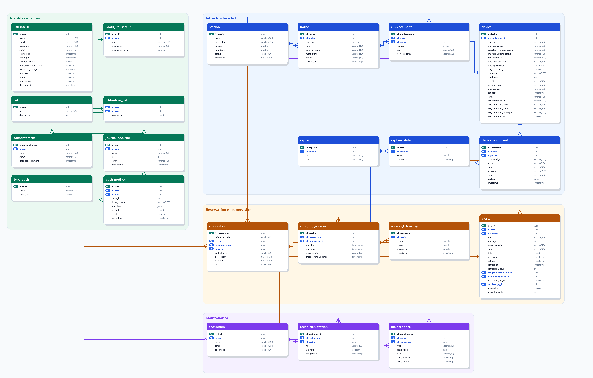

Référence du MCD et du schéma PostgreSQL
========================================

Cette page ouvre la partie modèle de données. Elle présente d’abord la cible
fonctionnelle : schéma relationnel, champs, valeurs attendues, relations et
script PostgreSQL représentatif. La page :doc:`data_model` vient ensuite pour
expliquer les arbitrages entre cette cible et l’implémentation Django réellement
utilisée par l’application.

Le schéma est aligné avec le modèle Django actuel. Les tables techniques ajoutées
par Django pour les groupes et permissions ne sont pas détaillées ici : elles
font partie du socle d’administration Django, pas du domaine métier de la
station.

Principes de modélisation
-------------------------

La base est organisée autour de cinq ensembles fonctionnels :

* **comptes et sécurité** : utilisateurs, profils, rôles, moyens
  d’authentification, consentements et journal de sécurité ;
* **infrastructure terrain** : stations, bornes physiques, emplacements de
  charge, devices ESP32 et capteurs ;
* **réservation et session** : réservation utilisateur, authentification choisie
  et session de charge effective ;
* **télémétrie et alertes** : mesures capteurs, mesures électriques et alertes
  opérationnelles ;
* **maintenance** : techniciens et interventions planifiées.

Les valeurs textuelles comme ``statut`` ou ``status`` restent stockées en
``VARCHAR`` dans la base. Les cycles métier principaux sont néanmoins verrouillés
côté Django avec des ``TextChoices`` et exposés dans les formulaires
d'administration sous forme de listes fermées. Des contraintes ``CHECK`` sont
également ajoutées par les migrations Django pour empêcher les valeurs hors
catalogue au niveau de la base. Ce choix garde la base compatible avec SQLite et
PostgreSQL tout en évitant les statuts libres dans l'API.

Les familles qui peuvent évoluer avec le terrain, comme les types de capteurs,
les types d'alertes et les types d'intervention, restent volontairement plus
extensibles.

Vue relationnelle
-----------------

Le schéma relationnel est maintenu sous deux formes :

* une description textuelle lisible directement dans la documentation ;
* une source DBML importable dans dbdiagram.io :
  :download:`station_recharge.dbml <_static/dbdiagram/station_recharge.dbml>`.

Le fichier DBML sert aussi de source au diagramme entités-relations généré pour
la documentation :

Le rendu PNG peut être régénéré avec :

.. code-block:: powershell

   .\.venv\Scripts\python.exe scripts\generate_er_diagram.py

Les relations principales sont les suivantes :

.. list-table::
   :header-rows: 1
   :widths: 24 24 52

   * - Source
     - Cible
     - Sens métier
   * - ``utilisateur``
     - ``profil_utilisateur``
     - Un compte possède un profil utilisateur.
   * - ``utilisateur``
     - ``utilisateur_role`` / ``role``
     - Un compte peut recevoir plusieurs rôles.
   * - ``utilisateur``
     - ``consentement``
     - Les décisions de consentement sont historisées.
   * - ``utilisateur``
     - ``journal_securite``
     - Les actions sensibles sont journalisées.
   * - ``utilisateur``
     - ``auth_method``
     - Un compte peut posséder un ou plusieurs moyens d'accès.
   * - ``type_auth``
     - ``auth_method``
     - Chaque moyen d'accès est classé par type.
   * - ``station``
     - ``borne``
     - Une station contient une ou plusieurs bornes physiques.
   * - ``borne``
     - ``emplacement``
     - Une borne contient plusieurs emplacements.
   * - ``emplacement``
     - ``device``
     - Un emplacement est piloté par un équipement embarqué.
   * - ``device``
     - ``capteur``
     - Un ESP32 expose plusieurs capteurs.
   * - ``capteur``
     - ``capteur_data``
     - Chaque capteur produit une série de mesures horodatées.
   * - ``utilisateur``
     - ``reservation``
     - Un utilisateur réserve un emplacement sur un créneau.
   * - ``auth_method``
     - ``reservation``
     - La réservation référence le moyen d'accès choisi.
   * - ``reservation``
     - ``charging_session``
     - Une réservation peut ouvrir une session de charge.
   * - ``charging_session``
     - ``session_telemetry``
     - Les mesures électriques de session sont historisées.
   * - ``capteur_data`` / ``charging_session``
     - ``alerte``
     - Une alerte peut être expliquée par une mesure et/ou une session.
   * - ``utilisateur``
     - ``technicien``
     - Un technicien peut être lié à un compte utilisateur.
   * - ``technicien``
     - ``technicien_station``
     - Un technicien peut être autorisé sur plusieurs stations.
   * - ``station``
     - ``technicien_station``
     - Une station peut être suivie par plusieurs techniciens.
   * - ``station``
     - ``maintenance``
     - Une intervention concerne une station.
   * - ``technicien``
     - ``maintenance``
     - Une intervention peut être assignée à un technicien.

Clés structurantes
~~~~~~~~~~~~~~~~~~

.. list-table::
   :header-rows: 1
   :widths: 24 32 44

   * - Table
     - Clés principales
     - Contraintes importantes
   * - ``utilisateur``
     - ``id_user``
     - ``pseudo`` et ``email`` uniques.
   * - ``profil_utilisateur``
     - ``id_profil``, ``id_user``
     - Un profil par utilisateur.
   * - ``auth_method``
     - ``id_auth``, ``id_user``, ``id_type``
     - Secret haché, expiration et activation.
   * - ``station``
     - ``id_station``
     - Nom, localisation et statut d'exploitation.
   * - ``borne``
     - ``id_borne``, ``id_station``
     - Numéro unique dans une station.
   * - ``emplacement``
     - ``id_emplacement``, ``id_borne``, ``id_station``
     - Numéro unique dans une borne.
   * - ``device``
     - ``id_device``, ``id_emplacement``
     - Un device par emplacement, ``last_seen`` pour la supervision.
   * - ``capteur``
     - ``id_capteur``, ``id_device``
     - Type et unité de mesure.
   * - ``capteur_data``
     - ``id_data``, ``id_capteur``
     - Valeur numérique et horodatage.
   * - ``reservation``
     - ``id_reservation``, ``reference_code``
     - Référence unique, créneau, statut et mode d'accès.
   * - ``charging_session``
     - ``id_session``, ``id_reservation``
     - Une session active par réservation ouverte.
   * - ``alerte``
     - ``id_alerte``
     - Type, sévérité, statut et timestamp.
   * - ``maintenance``
     - ``id_maintenance``, ``id_station``
     - Planification, réalisation et statut d'intervention.

Script de création PostgreSQL
-----------------------------

Ce script de création représente le schéma métier attendu sur PostgreSQL. Dans
le projet, les migrations Django restent la source opérationnelle pour créer et
faire évoluer la base.

.. code-block:: sql

   CREATE EXTENSION IF NOT EXISTS "uuid-ossp";

   CREATE TABLE utilisateur (
       id_user UUID PRIMARY KEY DEFAULT uuid_generate_v4(),
       pseudo VARCHAR(100) UNIQUE NOT NULL,
       email VARCHAR(254) UNIQUE NOT NULL,
       password VARCHAR(128) NOT NULL,
       statut VARCHAR(50) DEFAULT 'actif',
       created_at TIMESTAMP NOT NULL DEFAULT CURRENT_TIMESTAMP,
       last_login TIMESTAMP,
       failed_attempts INTEGER NOT NULL DEFAULT 0,
       is_active BOOLEAN NOT NULL DEFAULT TRUE,
       is_staff BOOLEAN NOT NULL DEFAULT FALSE,
       is_superuser BOOLEAN NOT NULL DEFAULT FALSE,
       date_joined TIMESTAMP NOT NULL DEFAULT CURRENT_TIMESTAMP
   );

   CREATE TABLE profil_utilisateur (
       id_profil UUID PRIMARY KEY DEFAULT uuid_generate_v4(),
       id_user UUID UNIQUE NOT NULL REFERENCES utilisateur(id_user) ON DELETE CASCADE,
       nom VARCHAR(100) NOT NULL DEFAULT '',
       telephone VARCHAR(20) NOT NULL DEFAULT ''
   );

   CREATE TABLE role (
       id_role UUID PRIMARY KEY DEFAULT uuid_generate_v4(),
       nom VARCHAR(50) UNIQUE NOT NULL,
       description TEXT NOT NULL DEFAULT ''
   );

   CREATE TABLE utilisateur_role (
       id_user UUID NOT NULL REFERENCES utilisateur(id_user) ON DELETE CASCADE,
       id_role UUID NOT NULL REFERENCES role(id_role) ON DELETE CASCADE,
       assigned_at TIMESTAMP NOT NULL DEFAULT CURRENT_TIMESTAMP,
       PRIMARY KEY (id_user, id_role)
   );

   CREATE TABLE consentement (
       id_consentement UUID PRIMARY KEY DEFAULT uuid_generate_v4(),
       id_user UUID NOT NULL REFERENCES utilisateur(id_user) ON DELETE CASCADE,
       type VARCHAR(100) NOT NULL,
       statut VARCHAR(50) NOT NULL,
       date_consentement TIMESTAMP NOT NULL DEFAULT CURRENT_TIMESTAMP
   );

   CREATE TABLE journal_securite (
       id_log UUID PRIMARY KEY DEFAULT uuid_generate_v4(),
       id_user UUID REFERENCES utilisateur(id_user) ON DELETE SET NULL,
       action VARCHAR(255) NOT NULL,
       ip INET NOT NULL,
       statut VARCHAR(50) NOT NULL,
       date_action TIMESTAMP NOT NULL DEFAULT CURRENT_TIMESTAMP
   );

   CREATE TABLE type_auth (
       id_type UUID PRIMARY KEY DEFAULT uuid_generate_v4(),
       libelle VARCHAR(50) UNIQUE NOT NULL,
       factor_level SMALLINT NOT NULL
   );

   CREATE TABLE auth_method (
       id_auth UUID PRIMARY KEY DEFAULT uuid_generate_v4(),
       id_user UUID NOT NULL REFERENCES utilisateur(id_user) ON DELETE CASCADE,
       id_type UUID NOT NULL REFERENCES type_auth(id_type) ON DELETE RESTRICT,
       secret_hash TEXT NOT NULL,
       display_value VARCHAR(255) NOT NULL DEFAULT '',
       metadata JSONB NOT NULL DEFAULT '{}'::jsonb,
       expiration TIMESTAMP,
       is_active BOOLEAN NOT NULL DEFAULT TRUE,
       created_at TIMESTAMP NOT NULL DEFAULT CURRENT_TIMESTAMP
   );

   CREATE TABLE station (
       id_station UUID PRIMARY KEY DEFAULT uuid_generate_v4(),
       nom VARCHAR(100) NOT NULL,
       localisation VARCHAR(255) NOT NULL,
       latitude DOUBLE PRECISION,
       longitude DOUBLE PRECISION,
       statut VARCHAR(50) NOT NULL,
       created_at TIMESTAMP NOT NULL DEFAULT CURRENT_TIMESTAMP
   );

   CREATE TABLE borne (
       id_borne UUID PRIMARY KEY DEFAULT uuid_generate_v4(),
       id_station UUID NOT NULL REFERENCES station(id_station) ON DELETE CASCADE,
       numero INTEGER NOT NULL,
       nom VARCHAR(100) NOT NULL,
       mqtt_prefix VARCHAR(100) NOT NULL DEFAULT 'station',
       statut VARCHAR(50) NOT NULL,
       created_at TIMESTAMP NOT NULL DEFAULT CURRENT_TIMESTAMP,
       UNIQUE (id_station, numero)
   );

   CREATE TABLE emplacement (
       id_emplacement UUID PRIMARY KEY DEFAULT uuid_generate_v4(),
       id_borne UUID NOT NULL REFERENCES borne(id_borne) ON DELETE CASCADE,
       id_station UUID NOT NULL REFERENCES station(id_station) ON DELETE CASCADE,
       numero INTEGER NOT NULL,
       etat VARCHAR(50) NOT NULL,
       statut_cadenas VARCHAR(50) NOT NULL,
       UNIQUE (id_borne, numero)
   );

   CREATE TABLE device (
       id_device UUID PRIMARY KEY DEFAULT uuid_generate_v4(),
       id_emplacement UUID UNIQUE NOT NULL REFERENCES emplacement(id_emplacement) ON DELETE CASCADE,
       type_device VARCHAR(50) NOT NULL,
       firmware_version VARCHAR(50) NOT NULL,
       ip_address INET,
       slot_id VARCHAR(50) NOT NULL DEFAULT '',
       hardware_mac VARCHAR(50) NOT NULL DEFAULT '',
       mac_address VARCHAR(50) NOT NULL DEFAULT '',
       last_seen TIMESTAMP,
       status VARCHAR(50) NOT NULL
   );

   CREATE TABLE capteur (
       id_capteur UUID PRIMARY KEY DEFAULT uuid_generate_v4(),
       id_device UUID REFERENCES device(id_device) ON DELETE CASCADE,
       type VARCHAR(50) NOT NULL,
       unite VARCHAR(20) NOT NULL
   );

   CREATE TABLE capteur_data (
       id_data UUID PRIMARY KEY DEFAULT uuid_generate_v4(),
       id_capteur UUID NOT NULL REFERENCES capteur(id_capteur) ON DELETE CASCADE,
       valeur DOUBLE PRECISION NOT NULL,
       timestamp TIMESTAMP NOT NULL DEFAULT CURRENT_TIMESTAMP
   );

   CREATE TABLE reservation (
       id_reservation UUID PRIMARY KEY DEFAULT uuid_generate_v4(),
       reference_code VARCHAR(12) UNIQUE,
       id_user UUID REFERENCES utilisateur(id_user) ON DELETE SET NULL,
       id_emplacement UUID NOT NULL REFERENCES emplacement(id_emplacement) ON DELETE CASCADE,
       id_auth UUID REFERENCES auth_method(id_auth) ON DELETE SET NULL,
       auth_choice VARCHAR(20) NOT NULL DEFAULT 'qr',
       date_debut TIMESTAMP NOT NULL,
       date_fin TIMESTAMP NOT NULL,
       statut VARCHAR(50) NOT NULL,
       CONSTRAINT reservation_date_fin_gt_debut CHECK (date_fin > date_debut)
   );

   CREATE TABLE charging_session (
       id_session UUID PRIMARY KEY DEFAULT uuid_generate_v4(),
       id_reservation UUID UNIQUE NOT NULL REFERENCES reservation(id_reservation) ON DELETE CASCADE,
       id_emplacement UUID NOT NULL REFERENCES emplacement(id_emplacement) ON DELETE CASCADE,
       start_time TIMESTAMP NOT NULL,
       end_time TIMESTAMP,
       charge_state VARCHAR(50) NOT NULL DEFAULT 'reserved',
       charge_state_updated_at TIMESTAMP NOT NULL DEFAULT CURRENT_TIMESTAMP,
       CONSTRAINT session_end_gt_start CHECK (end_time IS NULL OR end_time > start_time),
       CONSTRAINT chk_session_charge_state CHECK (
           charge_state IN (
               'reserved', 'access_validated', 'waiting_plug',
               'charging', 'stopping', 'stopped', 'error'
           )
       )
   );

   CREATE TABLE session_telemetry (
       id_telemetry UUID PRIMARY KEY DEFAULT uuid_generate_v4(),
       id_session UUID NOT NULL REFERENCES charging_session(id_session) ON DELETE CASCADE,
       courant DOUBLE PRECISION NOT NULL,
       tension DOUBLE PRECISION NOT NULL,
       energie_kwh DOUBLE PRECISION NOT NULL,
       timestamp TIMESTAMP NOT NULL DEFAULT CURRENT_TIMESTAMP
   );

   CREATE TABLE alerte (
       id_alerte UUID PRIMARY KEY DEFAULT uuid_generate_v4(),
       id_data UUID REFERENCES capteur_data(id_data) ON DELETE SET NULL,
       id_session UUID REFERENCES charging_session(id_session) ON DELETE SET NULL,
       type VARCHAR(50) NOT NULL,
       message TEXT NOT NULL,
       niveau_severite VARCHAR(50) NOT NULL,
       status VARCHAR(50) NOT NULL,
       date TIMESTAMP NOT NULL DEFAULT CURRENT_TIMESTAMP,
       first_seen TIMESTAMP NOT NULL DEFAULT CURRENT_TIMESTAMP,
       last_seen TIMESTAMP NOT NULL DEFAULT CURRENT_TIMESTAMP,
       notified_at TIMESTAMP,
       notification_count INTEGER NOT NULL DEFAULT 0,
       assigned_technician_id UUID,
       acknowledged_by_id UUID,
       acknowledged_at TIMESTAMP,
       resolved_by_id UUID,
       resolved_at TIMESTAMP,
       resolution_note TEXT NOT NULL DEFAULT ''
   );

   CREATE TABLE technicien (
       id_tech UUID PRIMARY KEY DEFAULT uuid_generate_v4(),
       id_user UUID UNIQUE REFERENCES utilisateur(id_user) ON DELETE SET NULL,
       nom VARCHAR(100) NOT NULL,
       email VARCHAR(254) UNIQUE NOT NULL,
       telephone VARCHAR(20) NOT NULL DEFAULT ''
   );

   CREATE TABLE technicien_station (
       id_assignment UUID PRIMARY KEY DEFAULT uuid_generate_v4(),
       id_technicien UUID NOT NULL REFERENCES technicien(id_tech) ON DELETE CASCADE,
       id_station UUID NOT NULL REFERENCES station(id_station) ON DELETE CASCADE,
       role VARCHAR(50) NOT NULL DEFAULT 'intervenant',
       is_active BOOLEAN NOT NULL DEFAULT TRUE,
       assigned_at TIMESTAMP NOT NULL DEFAULT CURRENT_TIMESTAMP,
       CONSTRAINT uq_technicien_station UNIQUE (id_technicien, id_station),
       CONSTRAINT chk_tech_station_role CHECK (role IN ('referent', 'intervenant', 'observateur'))
   );

   ALTER TABLE alerte
       ADD CONSTRAINT fk_alert_assigned_technician
           FOREIGN KEY (assigned_technician_id) REFERENCES technicien(id_tech) ON DELETE SET NULL,
       ADD CONSTRAINT fk_alert_acknowledged_by
           FOREIGN KEY (acknowledged_by_id) REFERENCES technicien(id_tech) ON DELETE SET NULL,
       ADD CONSTRAINT fk_alert_resolved_by
           FOREIGN KEY (resolved_by_id) REFERENCES technicien(id_tech) ON DELETE SET NULL;

   CREATE TABLE maintenance (
       id_maintenance UUID PRIMARY KEY DEFAULT uuid_generate_v4(),
       id_station UUID NOT NULL REFERENCES station(id_station) ON DELETE CASCADE,
       id_technicien UUID NOT NULL REFERENCES technicien(id_tech) ON DELETE CASCADE,
       type VARCHAR(100) NOT NULL,
       description TEXT NOT NULL,
       status VARCHAR(50) NOT NULL,
       date_planifiee TIMESTAMP NOT NULL,
       date_realisee TIMESTAMP
   );

   CREATE INDEX idx_user_is_active ON utilisateur(is_active);
   CREATE INDEX idx_user_date_joined ON utilisateur(date_joined);
   CREATE INDEX idx_consent_user_date ON consentement(id_user, date_consentement);
   CREATE INDEX idx_log_user_date ON journal_securite(id_user, date_action);
   CREATE INDEX idx_auth_user_type ON auth_method(id_user, id_type, is_active);
   CREATE INDEX idx_auth_expiration ON auth_method(expiration);
   CREATE INDEX idx_station_nom ON station(nom);
   CREATE INDEX idx_station_statut ON station(statut);
   CREATE INDEX idx_borne_station_statut ON borne(id_station, statut);
   CREATE INDEX idx_emp_borne_statut ON emplacement(id_borne, etat);
   CREATE INDEX idx_emp_station_statut ON emplacement(id_station, etat);
   CREATE INDEX idx_emp_lock_state ON emplacement(statut_cadenas, etat);
   CREATE INDEX idx_reservation_emp_dates ON reservation(id_emplacement, date_debut, date_fin);
   CREATE INDEX idx_res_user_date ON reservation(id_user, date_debut);
   CREATE INDEX idx_res_statut_date ON reservation(statut, date_debut);
   CREATE INDEX idx_res_dates ON reservation(date_debut, date_fin);
   CREATE INDEX idx_session_emplacement ON charging_session(id_emplacement);
   CREATE INDEX idx_session_start ON charging_session(start_time);
   CREATE INDEX idx_session_end ON charging_session(end_time);
   CREATE INDEX idx_session_window ON charging_session(start_time, end_time);
   CREATE INDEX idx_session_charge_state ON charging_session(charge_state, end_time);
   CREATE INDEX idx_telemetry_time ON session_telemetry(id_session, timestamp);
   CREATE INDEX idx_session_tel_ts ON session_telemetry(timestamp DESC);
   CREATE INDEX idx_device_last_seen ON device(last_seen);
   CREATE INDEX idx_device_status_seen ON device(status, last_seen);
   CREATE INDEX idx_capteur_type_dev ON capteur(type, id_device);
   CREATE INDEX idx_capteur_data_time ON capteur_data(id_capteur, timestamp);
   CREATE INDEX idx_capteur_data_ts ON capteur_data(timestamp DESC);
   CREATE INDEX idx_alert_status_time ON alerte(status, date);
   CREATE INDEX idx_alert_session_time ON alerte(id_session, date);
   CREATE INDEX idx_alert_ts ON alerte(date DESC);
   CREATE INDEX idx_alert_sev_time ON alerte(niveau_severite, date);
   CREATE INDEX idx_alert_type_time ON alerte(type, date);
   CREATE INDEX idx_alert_tech_status ON alerte(assigned_technician_id, status);
   CREATE INDEX idx_tech_station_tech ON technicien_station(id_technicien, is_active);
   CREATE INDEX idx_tech_station_station ON technicien_station(id_station, is_active);
   CREATE INDEX idx_maint_tech_date ON maintenance(id_technicien, date_planifiee);
   CREATE INDEX idx_maint_station_date ON maintenance(id_station, date_planifiee);
   CREATE INDEX idx_maint_status_date ON maintenance(status, date_planifiee);

   CREATE OR REPLACE VIEW session_anonyme AS
   SELECT
       cs.id_session,
       cs.start_time AS date_debut,
       cs.end_time AS date_fin,
       COALESCE(MAX(st.energie_kwh), 0)::double precision AS consommation_kwh,
       md5(COALESCE(r.id_user::text, cs.id_session::text)) AS user_hash
   FROM charging_session cs
   JOIN reservation r ON r.id_reservation = cs.id_reservation
   LEFT JOIN session_telemetry st ON st.id_session = cs.id_session
   GROUP BY cs.id_session, cs.start_time, cs.end_time, r.id_user;

Dictionnaire de données
-----------------------

``utilisateur``
~~~~~~~~~~~~~~~

Compte applicatif utilisé pour l’authentification, le portail utilisateur,
l’administration et le lien éventuel avec un technicien.

* ``id_user`` : UUID primaire. Exemple : ``7df7f18e-7b75-4c2f-93bc-4f6d2f4eab15``.
* ``pseudo`` : identifiant de connexion unique. Exemple : ``sarah.martin``.
* ``email`` : adresse email unique. Exemple : ``sarah.martin@example.com``.
* ``password`` : mot de passe haché par Django, jamais stocké en clair.
* ``statut`` : état fonctionnel du compte. Valeurs attendues :
  ``actif``, ``suspendu``, ``archive``.
* ``created_at`` : date de création métier du compte.
* ``last_login`` : dernière connexion connue, optionnelle.
* ``failed_attempts`` : compteur d’échecs d’authentification.
* ``is_active`` : booléen Django autorisant ou bloquant la connexion.
* ``is_staff`` : accès à l’administration Django.
* ``is_superuser`` : droits administrateur complets.
* ``date_joined`` : date d’inscription Django.

``profil_utilisateur``
~~~~~~~~~~~~~~~~~~~~~~

Extension personnelle du compte. La séparation avec ``utilisateur`` facilite les
traitements RGPD et les évolutions du profil.

* ``id_profil`` : UUID primaire.
* ``id_user`` : lien unique vers ``utilisateur``.
* ``nom`` : nom affiché dans l’interface. Exemple : ``Sarah Martin``.
* ``telephone`` : numéro de contact. Exemple : ``+33601020304``.

``role``
~~~~~~~~

Catalogue des rôles fonctionnels attribuables aux utilisateurs.

* ``id_role`` : UUID primaire.
* ``nom`` : rôle unique. Valeurs attendues : ``client``, ``technicien``,
  ``administrateur``.
* ``description`` : finalité du rôle. Exemple : ``Accès aux interventions``.

``utilisateur_role``
~~~~~~~~~~~~~~~~~~~~

Table d’association entre comptes et rôles.

* ``id_user`` : utilisateur concerné.
* ``id_role`` : rôle attribué.
* ``assigned_at`` : date d’attribution.

``consentement``
~~~~~~~~~~~~~~~~

Historise les décisions utilisateur sur les traitements de données.

* ``id_consentement`` : UUID primaire.
* ``id_user`` : utilisateur concerné.
* ``type`` : nature du consentement. Valeurs fermées côté application :
  ``cgu``, ``politique_confidentialite``, ``notifications``.
* ``statut`` : décision. Valeurs fermées côté application : ``accepte``,
  ``refuse``.
* ``date_consentement`` : date de décision.

Cette table est utile si elle est exploitée comme preuve de choix utilisateur.
Elle ne remplace pas les autres bases légales RGPD : la création de compte, la
réservation, la facturation ou la sécurité peuvent relever du contrat, de
l’intérêt légitime ou d’une obligation légale. Le consentement doit être réservé
aux traitements optionnels, par exemple les notifications non indispensables ou
les mesures d’audience.

Dans l’application actuelle, ``consentement`` est modélisée, visible dans
l’administration Django, exportée dans les données personnelles du compte et
alimentée automatiquement à l’inscription. Le formulaire collecte les choix
RGPD explicites et l’API crée une ligne historisée par décision :

* ``cgu/accepte`` pour les conditions générales d’utilisation ;
* ``politique_confidentialite/accepte`` pour la prise de connaissance de
  l’information RGPD ;
* ``notifications/accepte`` ou ``notifications/refuse`` pour les communications
  optionnelles liées au service.

Le profil utilisateur permet ensuite de modifier le choix lié aux notifications.
Chaque changement ajoute une nouvelle ligne datée, par exemple
``notifications/refuse`` après une acceptation initiale. Cette approche conserve
la preuve datée de chaque décision.

``journal_securite``
~~~~~~~~~~~~~~~~~~~~

Journal d’audit des actions sensibles.

* ``id_log`` : UUID primaire.
* ``id_user`` : utilisateur associé, conservé à ``NULL`` si le compte disparaît.
* ``action`` : action tracée. Exemple : ``login:success`` ou
  ``rfid:revoked``.
* ``ip`` : adresse IP source. Exemple : ``192.168.1.25``.
* ``statut`` : résultat. Valeurs attendues : ``success``, ``failure``.
* ``date_action`` : horodatage de l’événement.

``type_auth``
~~~~~~~~~~~~~

Catalogue des moyens d’authentification.

* ``id_type`` : UUID primaire.
* ``libelle`` : libellé unique. Valeurs attendues : ``RFID``, ``qr``,
  ``code``.
* ``factor_level`` : niveau d’assurance. Exemple : ``1`` pour RFID,
  ``2`` pour code SMS temporaire.

``auth_method``
~~~~~~~~~~~~~~~

Moyen d’authentification lié à un utilisateur. Les secrets sont hachés.

* ``id_auth`` : UUID primaire.
* ``id_user`` : propriétaire du moyen d’accès.
* ``id_type`` : type d’authentification.
* ``secret_hash`` : secret haché. Exemple : hash du badge RFID ou du token QR.
* ``display_value`` : valeur affichable lorsque le parcours l’autorise, par
  exemple un code SMS temporaire.
* ``metadata`` : métadonnées JSON. Exemple : ``{"reservation_code": "A1B2C3"}``.
* ``expiration`` : date de fin de validité, surtout pour QR/code SMS temporaire.
* ``is_active`` : moyen actif ou révoqué.
* ``created_at`` : date de création.

``station``
~~~~~~~~~~~

Site physique de recharge.

* ``id_station`` : UUID primaire.
* ``nom`` : nom public. Exemple : ``Station Centre Ville``.
* ``localisation`` : adresse ou description. Exemple : ``12 rue de Paris``.
* ``latitude`` : coordonnée GPS optionnelle. Exemple : ``48.8566``.
* ``longitude`` : coordonnée GPS optionnelle. Exemple : ``2.3522``.
* ``statut`` : état du site. Valeurs fermées côté application : ``active``,
  ``maintenance``, ``inactive``.
* ``created_at`` : date d’enregistrement.

``borne``
~~~~~~~~~

Équipement physique installé dans une station. Une borne peut piloter plusieurs
emplacements et porte la configuration locale utilisée par le Raspberry et MQTT.

* ``id_borne`` : UUID primaire.
* ``id_station`` : station parente.
* ``numero`` : numéro de borne unique dans la station. Exemple : ``1``.
* ``nom`` : libellé lisible. Exemple : ``Borne 1``.
* ``mqtt_prefix`` : préfixe MQTT utilisé pour router les messages terrain.
  Exemple : ``station``.
* ``statut`` : état d'exploitation. Valeurs fermées côté application :
  ``active``, ``maintenance``, ``inactive``.
* ``created_at`` : date d’enregistrement.

``emplacement``
~~~~~~~~~~~~~~~

Point de charge numéroté dans une borne.

* ``id_emplacement`` : UUID primaire.
* ``id_borne`` : borne parente.
* ``id_station`` : station dérivée de la borne, conservée pour les filtres et les
  requêtes de disponibilité.
* ``numero`` : numéro visible sur la borne. Exemple : ``1``.
* ``etat`` : disponibilité opérationnelle. Valeurs fermées côté application :
  ``disponible``, ``reserve``, ``occupe``, ``maintenance``.
* ``statut_cadenas`` : état du verrou. Valeurs fermées côté application :
  ``verrouille``, ``deverrouille``, ``bloque``.

``device``
~~~~~~~~~~

Équipement embarqué associé à un emplacement, typiquement un ESP32.

* ``id_device`` : UUID primaire.
* ``id_emplacement`` : emplacement équipé, unique.
* ``type_device`` : type matériel. Exemple : ``ESP32``.
* ``firmware_version`` : version embarquée. Exemple : ``1.2.0``.
* ``ip_address`` : adresse IP locale si disponible. Exemple : ``192.168.1.42``.
* ``slot_id`` : identifiant logique MQTT de l'emplacement. Exemple : ``slot1``.
* ``hardware_mac`` : adresse MAC physique Wi-Fi de l'ESP32. Exemple :
  ``AA:BB:CC:DD:EE:FF``.
* ``mac_address`` : ancien champ conservé en compatibilité pendant la migration ;
  il contient encore souvent l'ancien ``slot_id`` logique.
* ``last_seen`` : dernière télémétrie reçue. Ce champ sert à calculer la
  connexion opérationnelle de l'ESP32 dans l'interface de supervision.
* ``status`` : dernier état métier remonté par l'équipement. Valeurs observées :
  ``provisioned`` pour un ESP32 configuré mais jamais vu, ``online`` ou
  ``idle`` pour un ESP32 disponible, ``charging`` pour une charge en cours,
  ``offline`` pour un état explicitement remonté hors ligne et ``error`` pour
  une anomalie embarquée. La disponibilité réelle ne doit pas être déduite de ce
  champ seul : elle dépend de la fraîcheur de ``last_seen``.
* ``last_command_id`` : identifiant de la dernière commande acquittée par
  l'ESP32.
* ``last_command_action`` : action de la dernière commande. Exemple :
  ``START`` ou ``STOP``.
* ``last_command_status`` : statut de l'ACK reçu. Exemple : ``accepted`` ou
  ``stopped``.
* ``last_command_message`` : message lisible renvoyé par le firmware.
* ``last_command_at`` : horodatage du dernier ACK reçu.

``device_command_log``
~~~~~~~~~~~~~~~~~~~~~~

Historique des acquittements de commandes reçus depuis les ESP32.

* ``id_command`` : UUID primaire.
* ``id_device`` : ESP32 ayant répondu.
* ``id_session`` : session de charge associée lorsque le payload contient un
  ``session_id`` exploitable.
* ``command_id`` : identifiant de corrélation envoyé par le Raspberry ou le
  backend.
* ``action`` : commande concernée. Exemple : ``START`` ou ``STOP``.
* ``status`` : statut renvoyé par le firmware. Exemple : ``accepted`` ou
  ``stopped``.
* ``message`` : message lisible pour l'exploitation.
* ``source`` : origine déclarée de la commande. Exemple : ``raspberry``.
* ``payload`` : payload ACK brut conservé pour diagnostic.
* ``timestamp`` : horodatage de l'ACK.

``capteur``
~~~~~~~~~~~

Capteur logique exposé par un device.

* ``id_capteur`` : UUID primaire.
* ``id_device`` : device porteur.
* ``type`` : type de mesure. Valeurs attendues : ``temperature``,
  ``door``, ``cable``, ``current``, ``voltage``.
* ``unite`` : unité de mesure. Exemples : ``C``, ``bool``, ``A``, ``V``.

``capteur_data``
~~~~~~~~~~~~~~~~

Mesure brute produite par un capteur.

* ``id_data`` : UUID primaire.
* ``id_capteur`` : capteur source.
* ``valeur`` : valeur numérique. Exemple : ``1`` pour ``door`` ouvert,
  ``0`` pour fermé, ``31.7`` pour une température.
* ``timestamp`` : date de réception de la mesure.

``reservation``
~~~~~~~~~~~~~~~

Réservation d’un emplacement sur un créneau donné.

* ``id_reservation`` : UUID primaire.
* ``reference_code`` : code court unique affiché à l’utilisateur. Exemple :
  ``R7K2Q9``.
* ``id_user`` : utilisateur demandeur, nullable pour conserver l'historique
  après suppression ou anonymisation.
* ``id_emplacement`` : emplacement réservé.
* ``id_auth`` : moyen d’accès associé, nullable si le moyen est révoqué.
* ``auth_choice`` : mode choisi. Valeurs fermées côté API : ``rfid``, ``qr``,
  ``code``.
* ``date_debut`` : début du créneau.
* ``date_fin`` : fin du créneau, strictement après ``date_debut``.
* ``statut`` : cycle de vie. Valeurs fermées côté application :
  ``en_attente``, ``confirmee``, ``active``, ``annulee``, ``terminee``.

``charging_session``
~~~~~~~~~~~~~~~~~~~~

Session de charge effective ouverte à partir d’une réservation.

* ``id_session`` : UUID primaire.
* ``id_reservation`` : réservation source, unique.
* ``id_emplacement`` : emplacement utilisé.
* ``start_time`` : début réel de charge.
* ``end_time`` : fin réelle de charge, ``NULL`` tant que la session est active.
* ``charge_state`` : état métier de charge. Valeurs fermées côté application :
  ``reserved``, ``access_validated``, ``waiting_plug``, ``charging``,
  ``stopping``, ``stopped``, ``error``.
* ``charge_state_updated_at`` : date de dernière transition d'état.

``session_telemetry``
~~~~~~~~~~~~~~~~~~~~~

Télémétrie électrique associée à une session.

* ``id_telemetry`` : UUID primaire.
* ``id_session`` : session concernée.
* ``courant`` : intensité en ampères. Exemple : ``12.4``.
* ``tension`` : tension en volts. Exemple : ``230.0``.
* ``energie_kwh`` : énergie cumulée. Exemple : ``4.72``.
* ``timestamp`` : date de mesure.

``alerte``
~~~~~~~~~~

Incident opérationnel issu d’une mesure capteur ou d’une session.

* ``id_alerte`` : UUID primaire.
* ``id_data`` : mesure source si l’alerte vient d’un capteur.
* ``id_session`` : session concernée si l’alerte est liée à une charge.
* ``type`` : famille d’alerte. Valeurs observées : ``intrusion``,
  ``cable_removed``.
* ``message`` : message lisible. Exemple : ``Câble retiré pendant une charge active.``.
* ``niveau_severite`` : priorité. Valeurs fermées côté application :
  ``basse``, ``moyenne``, ``haute``, ``critical``, ``critique``.
* ``status`` : cycle de vie. Valeurs fermées côté application : ``nouvelle``,
  ``active``, ``prise_en_charge``, ``resolue``, ``closed``, ``fermee``.
* ``date`` : date de création ou de dernière mise à jour.
* ``first_seen`` : premier signal de l'anomalie.
* ``last_seen`` : dernière observation de la même anomalie.
* ``notified_at`` : date du dernier email envoyé, si une notification a été
  déclenchée.
* ``notification_count`` : nombre de notifications envoyées pour limiter les
  relances.
* ``assigned_technician_id`` : technicien responsable de l'alerte, si elle a
  été affectée ou prise en charge.
* ``acknowledged_by_id`` : technicien ayant pris en charge l'alerte.
* ``acknowledged_at`` : date de prise en charge.
* ``resolved_by_id`` : technicien ayant clôturé l'alerte.
* ``resolved_at`` : date de clôture opérationnelle.
* ``resolution_note`` : note d'intervention ou justification de résolution.

``technicien``
~~~~~~~~~~~~~~

Profil opérationnel d’un intervenant de maintenance.

* ``id_tech`` : UUID primaire.
* ``id_user`` : compte applicatif associé, optionnel.
* ``nom`` : nom de l’intervenant. Exemple : ``Nadia Leroy``.
* ``email`` : email professionnel unique.
* ``telephone`` : numéro de contact.

``maintenance``
~~~~~~~~~~~~~~~

Intervention planifiée ou réalisée sur une station.

* ``id_maintenance`` : UUID primaire.
* ``id_station`` : station concernée.
* ``id_technicien`` : technicien assigné.
* ``type`` : nature de l’intervention. Valeurs attendues : ``preventive``,
  ``corrective``, ``diagnostic``.
* ``description`` : détail de l’intervention.
* ``status`` : avancement. Valeurs fermées côté application : ``planifiee``,
  ``en_cours``, ``realisee``, ``annulee``.
* ``date_planifiee`` : date prévue.
* ``date_realisee`` : date effective, optionnelle tant que l'intervention n'est
  pas terminée.

Vue ``session_anonyme``
~~~~~~~~~~~~~~~~~~~~~~~

Vue d’exploitation statistique sans identifiant utilisateur direct.

* ``id_session`` : session analysée.
* ``date_debut`` : début réel de session.
* ``date_fin`` : fin réelle, optionnelle.
* ``consommation_kwh`` : consommation estimée depuis la télémétrie.
* ``user_hash`` : hachage stable de l’utilisateur, ou valeur de repli si le lien
  utilisateur n’existe plus.

Lecture fonctionnelle
---------------------

Le MCD privilégie une séparation nette entre la réservation et la session. Une
réservation représente un droit d’accès planifié ; une session représente
l’usage réel du point de charge. Cette distinction permet de gérer les
annulations, les absences, les démarrages tardifs et les sessions encore
ouvertes.

Les mesures capteurs sont conservées indépendamment des alertes. Une alerte peut
donc pointer vers la mesure qui l’a déclenchée, tout en portant son propre cycle
de vie. Cela évite de transformer chaque mesure anormale en incident distinct :
une anomalie persistante peut faire évoluer une alerte existante de ``nouvelle``
vers ``active``, puis ``prise_en_charge`` lorsqu'un technicien intervient, puis
``resolue`` lorsque la télémétrie revient à la normale ou que l'incident est
clôturé après vérification.

Les moyens d’authentification sont séparés des réservations afin de prendre en
charge plusieurs modes d’accès : RFID durable, QR code temporaire et code SMS.
Le secret reste haché ; la valeur affichable est limitée aux parcours où elle est
nécessaire à l’utilisateur.
