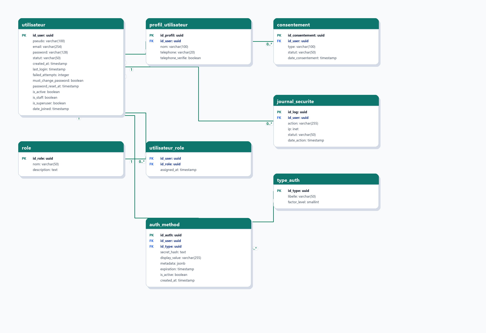
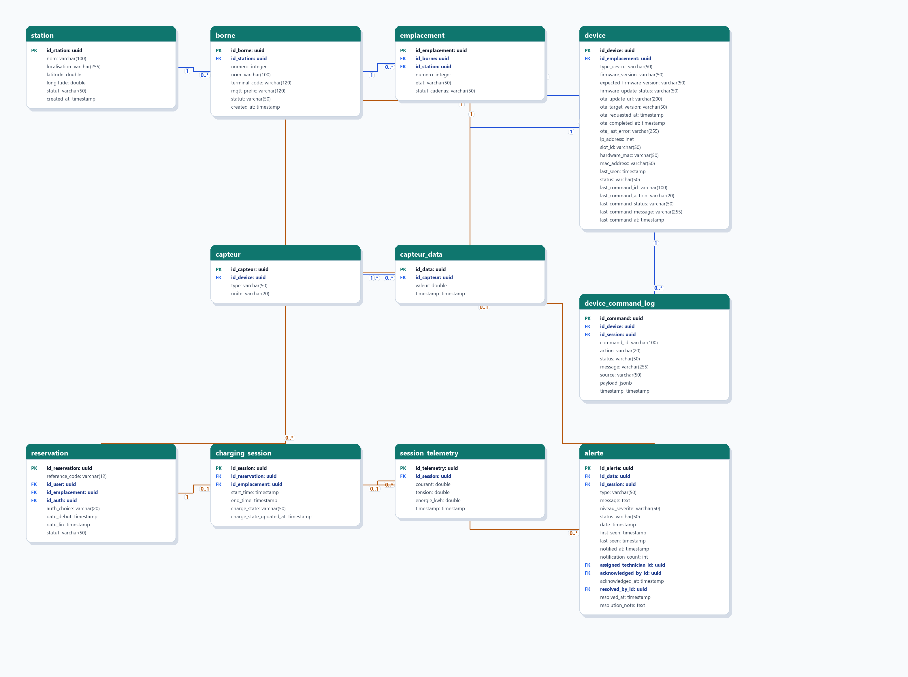
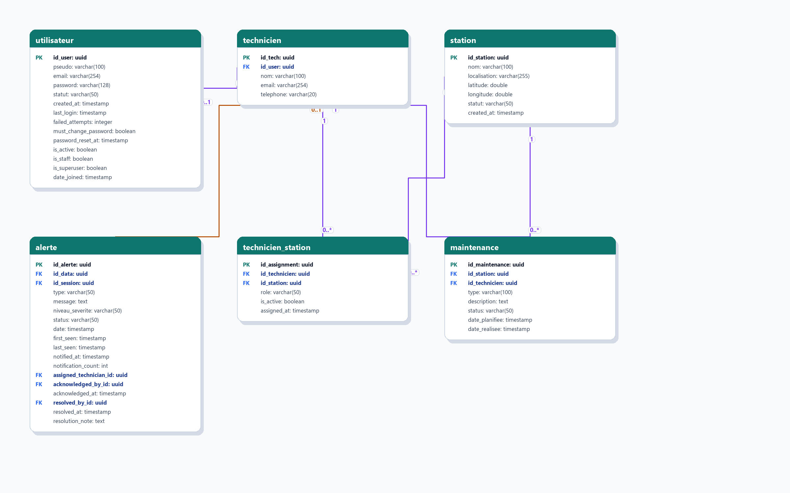

Diagrammes de classes UML
=========================

Cette page complète la référence du schéma relationnel avec une lecture plus
orientée objet. Les diagrammes de classes UML ne remplacent pas le MCD complet :
ils servent à présenter les grands blocs fonctionnels du modèle sans surcharger
une seule image.

Les classes sont issues du fichier DBML utilisé par la page :doc:`database_mcd`.
Les champs marqués ``PK`` représentent les identifiants principaux et les champs
marqués ``FK`` les références vers d'autres classes.

Régénération des diagrammes
---------------------------

Les images peuvent être régénérées depuis la racine du projet avec :

.. code-block:: powershell

   .\.venv\Scripts\python.exe scripts\generate_uml_class_diagrams.py

Identités et accès
------------------

Ce diagramme regroupe les comptes, profils, rôles, consentements, journaux de
sécurité et moyens d'authentification.

Infrastructure, réservation et supervision
------------------------------------------

Ce diagramme montre la chaîne principale du projet : station, borne,
emplacement, ESP32, capteurs, réservation, session de charge, télémétrie,
commandes MQTT et alertes.

Maintenance et exploitation
---------------------------

Ce diagramme isole le périmètre technicien : rattachement à un compte,
affectation aux stations, interventions de maintenance et prise en charge des
alertes.

